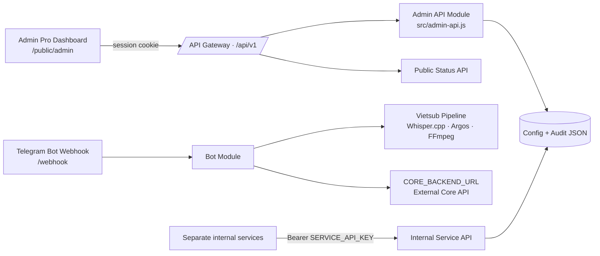

# HENDY Admin Pro — API architecture

## Topology



`index.js` handles HTTP serving and Telegram webhook dispatch. `src/admin-api.js` owns Admin sessions, public status, internal service endpoints, maintenance/config state, connector checks, API catalog and audit log. `src/subtitles.js` owns local transcription/translation/render work. `public/admin/` is the independent dashboard client and communicates only through JSON API calls.

## Authentication boundaries

- Browser Admin API: password login with `ADMIN_PANEL_PASSWORD`; server-created random session token is stored in an `HttpOnly`, `SameSite=Strict` cookie. Sessions expire after eight hours and are in-memory, so restarting the server signs out all sessions.
- Module-to-module API: `Authorization: Bearer <SERVICE_API_KEY>`. Give the key only to trusted services through their secret environment variables. This key is separate from `BOT_TOKEN` and `ADMIN_PANEL_PASSWORD`.
- Public status: no authentication, and response contains no secrets.
- Telegram webhook: `X-Telegram-Bot-Api-Secret-Token` must match `WEBHOOK_SECRET_TOKEN` when configured.

## Internal service examples

```bash
curl -H "Authorization: Bearer $SERVICE_API_KEY" \
  https://YOUR-SERVICE.onrender.com/api/v1/internal/status

curl -H "Authorization: Bearer $SERVICE_API_KEY" \
  https://YOUR-SERVICE.onrender.com/api/v1/internal/config

curl -X POST \
  -H "Authorization: Bearer $SERVICE_API_KEY" \
  -H "X-Service-Name: vietsub-worker" \
  -H "Content-Type: application/json" \
  -d '{"event":"job.completed","details":{"jobId":"example-job"}}' \
  https://YOUR-SERVICE.onrender.com/api/v1/internal/events
```

Never paste a real key into source code or commit it to GitHub.

## Persistence and scaling

Config and audit events are JSON-file backed for a small single-instance deployment. For multiple instances, scale-out, or audit retention guarantees, replace the persistence helper in `src/admin-api.js` with PostgreSQL/Redis storage. Current overview metrics describe the running process and in-memory placeholder user/job state, not a complete durable business database.
